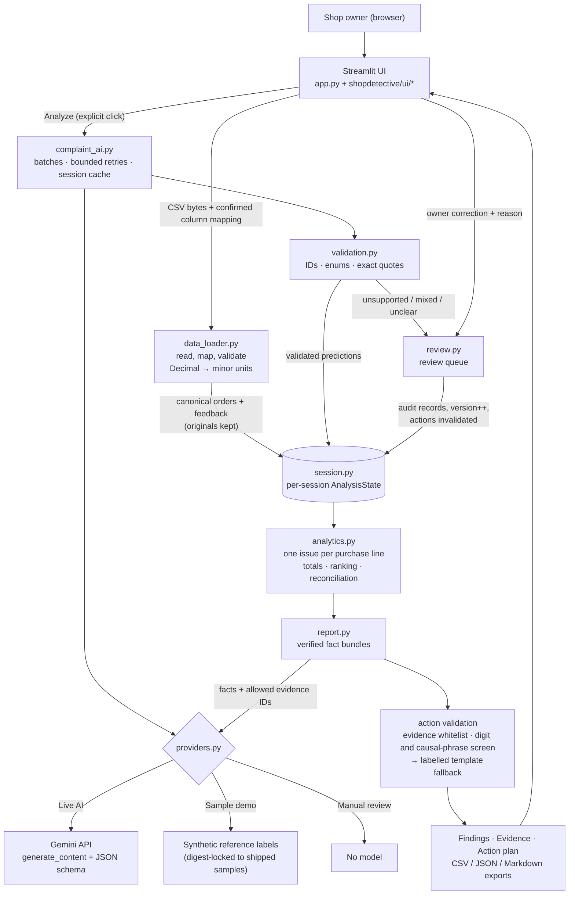

# Architecture

ShopDetective is a single Streamlit/Python application. The UI, validation, AI adapter, analytics and exports run in one server process. Each browser session gets its own `AnalysisState` in `st.session_state`. There is no separate API, queue, vector store, database or account system; this is a deliberate choice for a single-owner tool. Session data is temporary, and downloads are the durable output.

Arrows show data flow and function calls inside one process. Only the Gemini box is an external network service.

The original design diagram is kept for reference at `assets/original_architecture.png` (also `reference/`). The implementation follows it. The main additions are the Manual review mode, link corrections, report versioning and the explicit unassigned-refund breakdown.

## Modules

| Module | Responsibility |
|---|---|
| `app.py` | Page config, header, sidebar, section navigation (a keyed radio, so a finding can navigate to its evidence) and report computation for the active filters |
| `config.py` | Limits, model default, prompt/schema/report versions, secret lookup (env → Streamlit secrets; `.env` via python-dotenv) |
| `schemas.py` | Pydantic `ClassificationResult`/`ClassificationBatch`/`ActionSuggestion`/`ActionPlanResponse`, category→detail enum map, prediction record, filters |
| `data_loader.py` | UTF-8/BOM CSV reading with actionable errors, header-based mapping suggestions, strict validation, digests, dataset build, sample loader |
| `prompts.py` | Versioned system prompts; messages are passed as a JSON array marked as data |
| `providers.py` | `GeminiProvider` (google-genai `client.models.generate_content`, `response_mime_type="application/json"`, `response_json_schema`, request timeout, AFC disabled), `SampleReferenceProvider`, `ManualReviewProvider`; SDK errors mapped to safe codes (auth/model/rate-limit/server/timeout) |
| `complaint_ai.py` | Selects messages (skips empty/oversized and owner-resolved lines), session cache lookup, batches of `SD_BATCH_SIZE` (default 15), at most 3 attempts with exponential backoff and jitter, non-retryable errors abort while completed results are kept |
| `validation.py` | Per-item schema validation, duplicate/unknown/missing ID handling, exact quote support after CRLF/CR → LF only |
| `analytics.py` | Item-level resolution (owner correction › consistent accepted labels › review), scope filtering, deduplicated totals, ranking, unassigned breakdown, reconciliation assertion |
| `review.py` | Review queue, item-assignment and explicit link corrections with validation and `local_reviewer` audit records |
| `report.py` | Fact bundles, action validation and templates, freshness check (report version + product/date scope), CSV (formula-safe) / JSON / Markdown exports with metadata |
| `session.py` | `AnalysisState`, `Dataset`, `Correction`, `ActionPlan`; dataset replacement resets incompatible state |
| `evaluation.py` | Keyword baseline and precision/recall/F1/abstention/quote-validity metrics |

## Key invariants (all covered by tests)

- Money is held as integers in minor units, and amounts in the UI and exports come from the orders table only.
- At most one accepted issue per purchase line. Duplicate messages add evidence, never amount.
- `issue-associated + unassigned == recorded refunds` for every filter scope (asserted in `compute_report`).
- Predictions and corrections are stored separately. Corrections win for their purchase line, are never re-sent to the model, and are not overwritten by later batches.
- A correction increments the report version, and action plans are only shown or exported when their version and product/date scope match. Category/review-status filters are display-only for the findings list and findings export rows.
- The cache is per session and keyed by message digest + model + prompt version + schema version. **Reset everything** clears the whole session, including the cache.
- Upload confirmation is bound to the SHA-256 of both files' contents and the selected currency; any change requires validating again before activation.
- Amounts and totals are bounded (see README) and checked as Python integers before int64 storage.
- Sample reference labels are served only when the loaded feedback digest equals the shipped sample's digest.
- Logs record counts, codes and versions only. Secrets and customer text are never logged or exported (aside from the customer text in the evidence export the owner asked for).
