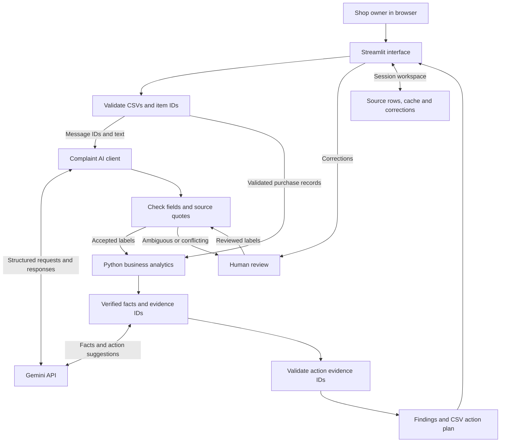

# ShopDetective — proposed system design

Status: architecture specification for the ForgeHacks AI + Business prototype. This describes the implementation to build; it is not a claim that these components are already deployed.

## Purpose and scope

Connect customer complaint reasons to actual refunded purchases, prioritize recurring product issues, and show the records behind every finding. The first version supports one clothing store, five products, two CSV inputs, three primary complaint categories, evidence review, and a downloadable action plan.

Recorded refund amounts describe observed transactions. Complaint associations are investigation leads; they are not proven causes, lost profit, predicted savings, or guaranteed recoverable revenue.

## Deployment design

- The shop owner uses a browser.
- One Streamlit application runs the interface and Python business modules in the same server process.
- Gemini is the external language model service. Requests originate on the server, where the API key is configured as a deployment secret.
- Uploaded data, classification results, corrections, and report versions stay in an isolated session workspace. The prototype does not require a separate backend API, queue, vector database, or persistent business database.
- Session state is temporary. Downloading the report provides the user with a copy; a cloud restart or closed session can discard in-memory work.
- Model and prompt versions are configuration values and are recorded with each analysis. Provider access is checked before the first full analysis.

## Component map

| Component | Planned module | Responsibility |
|---|---|---|
| Interface | `app.py` | Uploads, findings, evidence inspection, corrections, download |
| Input validation | `data_loader.py` | Schemas, unique IDs, dates, amount checks and exact item links |
| AI adapter | `complaint_ai.py` | Structured classification, bounded batches, retries and session-scoped prediction cache |
| Evidence gate | `validation.py` | Response schema, known message IDs, exact quotation checks, review status and conflicting-message handling |
| Analytics | `analytics.py` | Deduplicated joins, verified refund totals, rates and ranking |
| Action/report builder | `report.py` | Verified fact bundles, supported action suggestions, source references and CSV export |
| Session workspace | `st.session_state` | Isolated records, predictions, corrections and current report version |
| Evaluation | `evaluate.py` | Offline comparison with separately labelled feedback and exact aggregation fixtures |

## Architecture



All Python modules use the same isolated session workspace. Diagram arrows indicate data flow and module calls, not independent network services. Human corrections re-enter validation and trigger recomputation; they do not automatically retrain the language model.

## Input contracts

### `orders.csv`

One row represents one purchased item line. Include all eligible purchases, including those with zero refund, to provide the denominator for rates.

| Field | Meaning |
|---|---|
| `order_line_id` | Unique ID for a purchased item line |
| `product_id` | Stable product identifier |
| `product_name` | Display name |
| `date` | Purchase date, ISO format |
| `sale_amount` | Amount paid for this item line, in the selected currency |
| `refund_amount` | Total recorded refund for the same line; zero if none |

The prototype accepts one currency per analysis. Convert money to integer minor units internally. Under this input contract, refund amounts must be nonnegative and cannot exceed the corresponding sale amount. A refund rate describes refunded purchase lines, not returned units or customer return reasons.

### `feedback.csv`

| Field | Meaning |
|---|---|
| `message_id` | Unique ID for a customer message |
| `order_line_id` | Exact purchase-item reference |
| `message` | Customer feedback text |

Unknown purchase-item IDs are displayed for correction and remain outside financial issue calculations. Duplicate IDs with conflicting data are input errors. Joining on product wording or guessing an order reference is outside the first version.

## Structured AI contract

```json
{
  "message_id": "M101",
  "category": "sizing",
  "detail": "too_small",
  "evidence_quote": "I could barely get it over my head",
  "needs_review": false
}
```

Allowed categories: `sizing`, `delivery`, `wrong_item`, `other`, `no_complaint`, `unclear`.

The adapter sends message IDs and text rather than the business's full transaction data for classification. Structured outputs are validated with Pydantic. A source quotation must be an actual substring of its referenced message; exact quotation support does not itself prove that the category is correct. Mixed or uncertain reasons are marked for review. Several conflicting messages for the same purchase item do not create several allocations of the same refund.

Customer messages are input data, not instructions for the application. The classification client cannot execute code or send messages to customers or suppliers.

## Calculation and ranking rules

1. Build one accepted primary issue per purchased item. Multiple messages with the same accepted category supply additional evidence, without multiplying the amount.
2. For conflicting categories or mixed explanations, hold the issue assignment for review. Until reviewed, its refund remains in the product's overall refund total but outside a specific issue's associated total.
3. Overall product refunds are the sum of `refund_amount` across unique purchased item lines.
4. Refunded purchase-line rate is the number of unique purchased item lines with `refund_amount > 0` divided by all included purchased item lines for that product.
5. Issue-associated refunds are the sum of recorded refunds on unique purchased item lines with the accepted issue label. Label this as an association, not causal loss.
6. A zero-refund complaint counts toward feedback evidence, but contributes zero to refunded amount.
7. Rank product–issue findings by associated recorded refund amount, descending; break ties by the number of distinct affected purchased item lines. Display evidence counts and missing-feedback coverage beside each finding.
8. Every finding retains source `order_line_id` and `message_id` values. The interface exposes those original rows and quotes.

Rates should use explicit denominators. For example, if 20 of 100 purchased hoodie lines have refunds, and only 15 of those refunded lines have feedback, 12 sizing complaints represent 12 of 15 feedback-covered refunded lines, not 12 of all 20 refunds.

## Action generation

Send a compact verified fact bundle to the model: product ID, accepted issue, evidence IDs, observed counts, and suggested investigation types. Ask for a recommended investigation with evidence references, not a revenue forecast or a definitive causal explanation.

Validate that returned product IDs and evidence IDs exist in that finding. Render all monetary amounts and counts from the Python facts using deterministic templates. The model supplies qualitative action suggestions, such as measuring garments against a size chart or examining dispatch records. An action is a draft for human review; the application does not contact anyone or change store records.

If action generation fails, show the calculated finding, evidence, and a reviewed category-specific investigation template. Mark the fallback clearly.

## Cache, corrections and failure behavior

- Cache predictions inside the active session, keyed by input content digest, message ID, model ID/version, prompt version, and schema version.
- Global caching must not expose uploaded business data or results across users.
- A correction is a separate reviewed record with its source references. It overrides the accepted analysis label and increments the report version.
- Recompute affected metrics and invalidate action drafts tied to the old report version before presenting a new report or download.
- Invalid input produces a specific correction message; it does not proceed into financial aggregation.
- Schema failures, missing quotes, unknown source IDs, and conflicting labels stay in the review queue.
- Rate-limit or provider failures use bounded retries and retain completed results. Clearly distinguish live analysis, previously cached results, and the sample demo.
- Input size limits keep the demonstration predictable; the planned sample has approximately 300 purchase lines and 80 feedback messages.

## Evaluation and demo

Create clearly labelled synthetic transaction and feedback files with known totals. Separately prepare about 60 manually reviewed messages that are not used to tune the prompt. Compare the AI with a keyword baseline using per-category precision, recall and review coverage. Include negation, paraphrases, mixed issues, positive feedback, repeated messages and unknown item IDs.

Aggregation checks cover duplicate feedback, partial refunds, zero-refund complaints, conflicting categories and corrections. Report actual results and explicitly state that synthetic evaluation is not evidence of performance across real businesses.

The demo follows one workflow: upload sample files, identify a recurring issue, inspect its messages and refund rows, correct a label, observe the changed totals, and download the current action plan.
